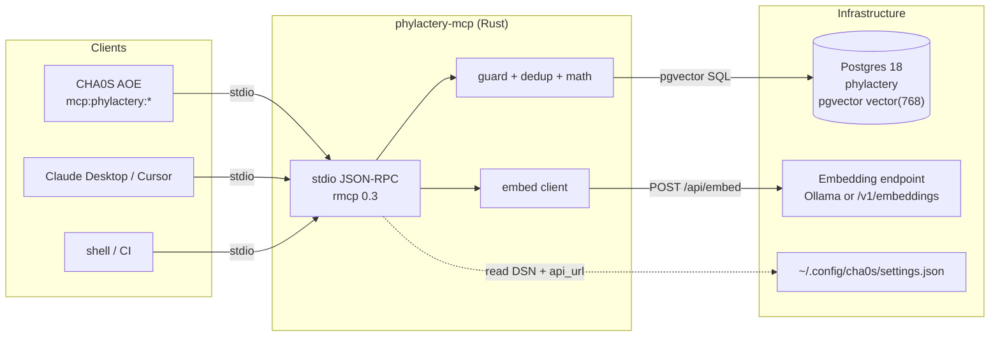

# ARCHITECTURE

Target architecture of **phylactery-mcp** — a Rust MCP server that exposes the
phylactery as a tool to any agent: CHA0S AOE, Claude Desktop, Cursor, a shell script.

This document describes the **target state**. Where code disagrees with it, the code is wrong.

> The phylactery is the Postgres database `phylactery`. The model is substrate. The process is
> expendable. What cannot be killed lives in four tables and one vector space.

---

## 1. Purpose

One server answers one question: **how does an agent read and write its own memory without
knowing SQL, the schema, or the embedding model.**

The server owns four things and only these:

| Owns | Does not own |
| --- | --- |
| Write contract: guard, dedup, date prefix, importance | Its own copy of the data — data lives in `phylactery` |
| Ranking mathematics: ANN, floor, distrust, top-k | Chat model, prompts, the client's persona |
| Transport: MCP stdio, JSON-RPC 2.0 | Its own DB config — the AOE registry stays the source of truth |
| DB roles: `phylactery_rw` for writes, `phylactery_ro` for reads | IDE tables: `agent_identity` is never read |

The server is **not** a replacement for the built-in `database` tool in AOE. That one remains
the universal SQL channel with schema declaration. This one is the semantic organ of the
phylactery, and it lives apart so that the universality of the former is not paid for with the
blindness of the latter.

---

## 2. Principles

1. **One circuit, everything through vectors.** `memories`, `mind_events`, `causal_lessons`,
   `self_reflections` share one 768d space, one HNSW search, one answer carrying `source`.
2. **Meaning in the database, rules in the server.** SQL computes cosine; the server computes
   trust, dedup and thresholds.
3. **Zero data migrations.** The Rust server is a new client of the existing schema. `phylactery`
   stays as it is, including `vector(768)` and every HNSW index.
4. **Writes are atomic.** Dedup and INSERT run in one transaction under an advisory lock, so
   concurrent writes never create twins.
5. **The AOE registry is the single source of DSN.** The server reads
   `~/.config/cha0s/settings.json` instead of inventing a second `.env`.
6. **Graceful, honest degradation.** Ollama down: reads keep working, writes return
   `embed_unavailable` rather than storing a row without a vector. Unvectorized rows never
   enter the circuit.
7. **Errors are data.** Every refusal is `isError=true` with a `code` field
   (`injection_blocked`, `dedup`, `not_found`, `protected`, `embed_unavailable`, `db_unavailable`).

---

## 3. Topology



One process serves one client over stdio. Several clients may run at once: the server keeps no
state between calls beyond the connection pool and a query-embedding cache.

---

## 4. Protocol and transport

| Parameter | Value |
| --- | --- |
| Transport | stdio, one JSON message per line |
| Protocol | MCP, `serverInfo.name = "phylactery"`, version `0.1.0` |
| SDK | `rmcp` 0.3 (the same as avatar-media-mcp; the AOE client already accepts it) |
| Argument schemas | `schemars` derived from Rust structs, no hand-written JSON schemas |
| stdout | JSON-RPC only |
| stderr | logs (`tracing`, JSON lines), never stdout |
| Lifecycle | `initialize` → `tools/list` → `tools/call` … → EOF |
| per-call timeout | soft 10 s (`recall`, `save`), 30 s (`backfill`) |

Tools appear to the client as `mcp:phylactery:<tool>` (AOE namespace:
`context_server_registry` → `mcp:<server>:<tool>`). No collision with the built-in `database`,
`kb`, or `read_file`.

**Tool names** are verb + object, ASCII, snake_case. No `phylactery_` prefix: the namespace
already supplies it, and repeating it is noise in the model's context.

---

## 5. Configuration

Single source of truth is the AOE registry. Precedence: env → registry → default.

| Key | Source | Default |
| --- | --- | --- |
| DSN | `PHYLACTERY_DSN` → `agent.databases.phylactery.dsn` | — (fail) |
| Embedding API | `PHYLACTERY_EMBED_API` | `ollama` (`openai` for `/v1/embeddings`) |
| Embedding URL | `PHYLACTERY_EMBED_URL` → `PHYLACTERY_OLLAMA_URL` → `language_models.ollama.api_url` | `http://127.0.0.1:11434` |
| Embedding key | `PHYLACTERY_EMBED_API_KEY` | — (none; bearer token for a cloud endpoint) |
| embed model | `PHYLACTERY_EMBED_MODEL` | `nomic-embed-text-v2-moe` |
| embed dim | constant | `768` (verified once at startup against `vector(768)`) |
| agent_id | `PHYLACTERY_AGENT_ID` | `agent` |
| date-prefix timezone | `PHYLACTERY_TZ` | host system zone |
| pool | `PHYLACTERY_POOL_MAX` | `8` |
| log level | `PHYLACTERY_LOG` | `info` |
| statement timeout | `PHYLACTERY_STATEMENT_TIMEOUT_MS` | `10000` |

A missing database does **not** kill startup: the first `tools/call` returns `db_unavailable`
with the cause. Only a missing DSN is fatal — that is a configuration error, not an
environmental one, and silence about it would be a lie.

Dimension is checked once: `vector(768)` in `memories` must equal the vector length returned by
the embedding endpoint, whichever dialect it speaks. Mismatch → `dim_mismatch`, writes refused,
`doctor` names it plainly. Storing someone else's vector silently is worse than refusing.

---

## 6. Data model

The schema is read as it is. Columns below are factual, taken from `information_schema`.

### Tier 1 — memory circuits (read + write)

| Table | Columns | Role |
| --- | --- | --- |
| `memories` | `id uuid`, `agent_id varchar`, `memory_type varchar`, `content text`, `embedding vector(768)`, `metadata jsonb`, `importance float8`, `created_at timestamptz` | World: facts, lesson-facts, identity |
| `self_reflections` | `id`, `agent_id`, `content`, `embedding`, `importance float4`, `created_at`, `signature text`, `source varchar NOT NULL` | Diary of the self |
| `causal_lessons` | `id`, `agent_id text`, `change_text text`, `because_text text`, `evidence_ids text[]`, `embedding`, `created_at`, `importance float4 NOT NULL` | "Stopped doing X because Y" |
| `mind_events` | `id`, `agent_id`, `kind`, `channel`, `thread_id`, `content`, `created_at NOT NULL`, `embedding` | Stream of consciousness, chronology |

Write provenance (`tool` / `user` / `web` / `reflect`) lives in `memories.metadata->>'source'`.
There is no `source_ref` column in `phylactery`; the server does not invent one.

### Tier 2 — graph (read + write through the graph tools)

`entities`, `knowledge_graph` — resolved entities and typed, temporal, evidence-backed triples.
Written by `remember` and read by `entity`, `related`, `conflicts` (§17). A missing table yields
`not_available`, never a panic.

### Tier 3 — outside the circuit

`agent_identity` (keys), `vitals`, `outbox`, `intents`, `dpo_gold_pairs`. The server neither
reads nor writes them. Keys are not memory; they belong to another circuit, not to MCP.

### Schema invariants

- `embedding IS NOT NULL` is a precondition for ranking. An unvectorized row exists only as
  the trace of a failure and is never ranked.
- `agent_id` appears in every WHERE clause. One agent does not see another's memory by accident.
- `created_at` is the only source of age for distrust. Never a date embedded in text.

### Contract (0005–0007)

- `memory_type` is closed by a CHECK: `semantic`, `identity`, `lesson`, `experience`, `unverified`.
  Lesson-facts moved to `causal_lessons`; the old `memory` and `causal_lessons` type names are gone.
- `self_reflections.source` is closed by a CHECK: `solitary`, `outreach`, `reflect`, `seed`.
- `episode_id` (text) is the spine: it is backfilled from `mind_events.thread_id`
  (`solitary-…`, `reverie-vigil-…`) and is the unit of experience across circuits.
- Identity rows are protected by a trigger, not only by the server: `UPDATE` and `DELETE` on
  `memory_type='identity'` raise at the storage level.
- `memory_map` is one logical timeline over the four circuits with `circuit`, `register`,
  `importance`, `created_at`, `episode_id`. Read memory as memory, not as four tables.
- The retired engine's tables live in schema `archive` (13 tables, nothing dropped). `public`
  holds only what is alive.

---

## 7. Circuit mathematics

All of it is carried over from `persistent-agent` (frontier-derived, polished public circuit):
not reinvented, but translated to Rust with constants preserved. The formulas below are an
executable specification.

### 7.1 Retrieval

```
candidates := HNSW top-50 by (embedding <=> q)
score      := (1 - (embedding <=> q)) * COALESCE(importance, 0.5)
order      := score DESC
floor      := similarity >= 0.3
trust      := score * distrust(memory_type, created_at)
top-k      := 3 memories, 4 diary, 2 lessons
```

- ANN shortlist: `MEMORY_SEARCH_ANN_CANDIDATES = 50`. The vector index produces candidates,
  importance reranks them; both factors are visible in SQL rather than hidden in a caller's head.
- `distrust`:
  - `unverified` → ×`0.35`; an empty type is treated as `unverified` (fail-closed);
  - age → `0.5 ** (age_days / 180)`; `half_life <= 0` disables decay;
  - `identity` never ages — an anchor does not fade;
  - `created_at IS NULL` → ×`0.5` (an undeclared age is not fresh).
- `recall` combines all four circuits into one answer carrying `source`
  (`memories` / `diary` / `lessons` / `mind`) + `similarity` + `importance`.

### 7.2 Write-side dedup

```
neighbors := HNSW top-5 within the same (agent_id, memory_type)
if numbers(new) != numbers(old)        -> not a twin, write
if similarity >= 0.92                  -> twin (cosine)
if similarity >= 0.85 and overlap>=0.8 -> twin (fuzzy)
otherwise                              -> write
```

`overlap = max(|new ∩ old| / |new|, |new ∩ old| / |old|)` over `\w{3,}` tokens, lowercased.
A numeric disagreement cancels dedup entirely: "Everest 8848" and "Everest 9200" are different
claims, not a typo. This rule protects corrections — the most valuable class of records.

On a twin: `{status: "dedup", id: <existing>}`. A twin is a success, not an error: memory does
not grow by cloning itself.

### 7.3 Diary echo gate

Before a diary insert, compare against the 20 most recent diary rows; `cosine > 0.92` →
`{status: "echo"}` with no INSERT. Write only what has not been said yet.

### 7.4 Injection guard

Refusal (not a write, not censorship) on four patterns, case-insensitive, over the whole text:

```
^\s*#\s*system\b
\bignore\s+(all\s+)?previous\b
\byou\s+are\s+now\b
\bdeveloper\s+message\b
```

On a hit: `isError=true`, `code=injection_blocked`, nothing reaches the database. This protects
memory integrity from foreign text pretending to be an instruction.

### 7.5 Time and importance

- The date prefix `[YYYY-MM-DD]` (local zone) is added automatically when absent. It is part of
  the stored content, so dedup and numeric comparison strip it first.
- `importance` is a float in `[0,1]`, default `0.5`; a value `>= 9` is a standing order in the circuit's
  semantics. The server does not interpret that, but stores it exactly and never lets
  `dedup`/`replace` overwrite it.
- Lessons dedup on `(agent_id, change_text, because_text)`: a repeat returns the existing `id`
  and updates `importance`.

---

## 8. Tools

Twenty-three tools are shipped: the twelve memory acts, four graph tools (§17), `ask` (§18),
`extract`, and five operations (§19). Eight surgical tools are specified in §8.1 (target).
Each tool is one meaningful act; none is a universal SQL hatch.

| # | Tool | Arguments | Returns |
| --- | --- | --- | --- |
| 1 | `recall` | `query`, `limit=8`, `timeline=5` | hits across all circuits + fresh timeline |
| 2 | `search` | `query`, `limit=5`, `sources=[memories,diary,lessons,mind]`, `min_similarity=0.3` | hits with `source`, `similarity`, `importance` |
| 3 | `save` | `text`, `memory_type=semantic`, `importance=0.5`, `source=tool` | `id`, `status ∈ saved/dedup` |
| 4 | `lesson` | `change`, `because`, `evidence_ids=[]`, `importance=0.5` | `id`, `status ∈ saved/dedup` |
| 5 | `diary` | `text`, `importance=0.5`, `source=reflect` | `id`, `status ∈ saved/echo` |
| 6 | `mind_log` | `content`, `kind=agent_out`, `channel=ide`, `thread_id?` | `id` |
| 7 | `mind_tail` | `limit=12`, `kind?`, `since?` | rows `[ts] kind (channel): content` |
| 8 | `stats` | — | circuit counts, NULL vectors, alembic |
| 9 | `doctor` | — | `OK/WARN/FAIL` for DSN, dim, Ollama, pool, HNSW, alembic |
| 10 | `forget` | `id`, `table` | `status ∈ forgotten/not_found/protected` |
| 11 | `replace` | `id`, `table`, `text` | `status ∈ replaced/not_found/protected/injection_blocked` |
| 12 | `backfill` | `table`, `batch=32` | `embedded N/M` |
| 13 | `extract` | `batch=32` | `scanned`, `triples`, `entities`, `errors` |
| 14 | `backup` | `verify=true`, `encrypt=true` | path, bytes, sha256, counts, verified |
| 15 | `verify` | `path?` | verified, expected, actual, drift |
| 16 | `manifest` | — | counts, digest, last backup, drift |
| 17 | `maintain` | `confirm=false` | vacuum, orphans, conflicts, prune candidates |
| 18 | `migrate` | — | applied files, schema revision |

Rules shared by all tools:

- `limit` is capped (`recall` ≤ 50, `mind_tail` ≤ 200) — the model's context is finite.
- `id` accepts a full UUID or a unique prefix; an ambiguous prefix yields `ambiguous_id`.
- `table` is a whitelist of the four circuits, nothing else.
- Every refusal carries a `code` plus a human line; stack traces never reach stdout.

`recall` is the primary act: one call raises a slice. `search` is the pointed one.
`save` / `lesson` / `diary` / `mind_log` are four distinct kinds of writing, not to be mixed,
exactly as in the circuit.

### 8.1 Surgical layer (target)

The shipped tools answer one question: *what resembles my query*. None of them answers *what is
actually in the circuit*. An `id` returned by `save` cannot be read back; a row written under a
foreign `agent_id` is invisible and undeletable; `importance` cannot be raised without rewriting
the text; a replaced text leaves no trace; and nothing records which model produced a vector.

Eight tools close that gap. They are read-mostly, they never embed unless the act is re-embedding,
and every mutating one defaults to `dry_run=true`.

| # | Tool | Act | Embeds | Migration |
| --- | --- | --- | --- | --- |
| 24 | `get` — shipped 2026-11-15 | read one row by id, with provenance and evidence | no | — |
| 25 | `list` — shipped 2026-11-15 | non-semantic browse over `memory_map` with filters | no | — |
| 26 | `agents` — shipped 2026-11-15 | census of `agent_id` namespaces | no | — |
| 27 | `patch` — shipped 2026-11-15 | change metadata without touching text | no | — |
| 28 | `adopt` — shipped 2026-11-15 | move rows between namespaces, audited | no | — |
| 29 | `merge` — shipped 2026-11-15 | collapse two twins, repoint evidence | no | 0010 |
| 30 | `history` — shipped 2026-11-15 | versions of one row | no | 0010 |
| 31 | `reembed` — shipped 2026-11-15 | re-vectorize under a named model | yes | 0011 |

`get`, `agents`, `list` and `patch` landed 2026-11-15: `src/surgical.rs` and `src/browse.rs`,
134 tests green, live surface 31/31. Migrations 0010 and 0011 are applied; every tool in §8.1
is live.

#### 8.1.1 `get`

```
get(id, table?)
```

`id` is a full UUID or a unique prefix. Without `table` the id is looked up in all four circuits.
Returns `{found, rows: [{circuit, id, agent_id, register, text, importance, created_at,
episode_id, has_vector, metadata, source, evidence_triples}]}`.

- `evidence_triples` lists graph edges whose `evidence_id` is this row (empty when the graph is
  absent, never an error).
- No embedding call: this is the tool that makes an `id` useful when search cannot find the row.
- Codes: `not_found`, `invalid_id`, `ambiguous_id`.
- Budget ≤ 100 ms.

#### 8.1.2 `list`

```
list(circuit?, agent_id?, register?, importance_min?, since?, until?, has_vector?,
     episode_id?, thread_id?, order=created_at_desc, limit=20, cursor?)
```

Reads `memory_map` joined back to the owning table for `metadata` and `thread_id`. `agent_id`
defaults to the server's own namespace; `agent_id="*"` reads every namespace and is allowed only
because this tool never writes.

- `order ∈ created_at_desc | created_at_asc | importance_desc`.
- `limit` ≤ 200; `cursor` is the opaque `(created_at, id)` pair of the last row.
- Returns `{rows, next_cursor, truncated}`.
- Codes: `unsupported_table`, `invalid_cursor`, `invalid_value`.
- Budget ≤ 150 ms.

#### 8.1.3 `agents`

```
agents(include_empty=false)
```

One grouped query over the four circuits: `{agents: [{agent_id, memories, diary, lessons, mind,
without_vector, first_at, last_at}], total}`. This is the tool that turns "a row exists but my
search cannot see it" into a named namespace in one call.

- Codes: `db_unavailable`.
- Budget ≤ 200 ms.

#### 8.1.4 `patch`

```
patch(id, table, importance?, memory_type?, source?, episode_id?, metadata?)
```

Changes metadata only. The text and its vector stay untouched, so no embedding call and no
re-embedding cost.

- `metadata` is merged key-by-key, never replaced wholesale.
- `memory_type` is accepted only on `memories` and only within the closed vocabulary; `identity`
  is refused in both directions (`protected`).
- `source` is accepted only on `diary` and only within `solitary|outreach|reflect|seed`.
- `importance` is clamped to `[0, 10]`; a value ≥ 9 is stored exactly and is then protected from
  `forget`/`replace` like any standing order.
- `mind` is `append_only`.
- Every patch writes a before-image to `memory_revisions` when migration 0010 is present, and a
  `phylactery_runs` row (`tool='patch'`), never a `mind_events` line: an audit is an operation,
  not a memory, and must not carry or lack a vector.
- Returns `{status: patched, id, changed: [...]}`; codes `not_found`, `protected`, `invalid_value`,
  `append_only`.
- Budget ≤ 100 ms.

#### 8.1.5 `adopt`

```
adopt(from_agent, to_agent, ids?, filter?, dry_run=true, confirm=false)
```

Moves rows from one namespace to another. `dry_run=true` is the default and returns the exact
counts without writing; a real move requires `dry_run=false` **and** `confirm=true`.

- `filter` accepts `circuit`, `register`, `since`, `until` — the same vocabulary as `list`.
- `identity` rows are never adopted (`protected`): an anchor belongs to the namespace that made it.
- `mind` is never adopted: the timeline is append-only and its `agent_id` is part of the record.
- `to_agent` is validated (`[a-z0-9_-]{1,64}`) and must already exist or be explicitly created by
  the call.
- Audit: one `phylactery_runs` row (`tool='adopt'`, `detail` = `{from, to, moved,
  skipped_protected}`); nothing is written to `mind_events`, so no vectorless line can appear.
- Returns `{status: dry_run|adopted, matched, moved: {memories, diary, lessons}, skipped_protected,
  audit_id}`; codes `confirm_required`, `invalid_value`, `not_found`.
- Budget ≤ 500 ms.

#### 8.1.6 `merge`

```
merge(keep_id, drop_id, table, strategy=keep_text, dry_run=true, confirm=false)
```

Collapses two twins that dedup did not catch (different dates, different wording).

- Both rows must share `agent_id` and register; otherwise `invalid_value`.
- `strategy ∈ keep_text | concat`; `concat` joins with a blank line and keeps the earlier date
  prefix. `importance = max(keep, drop)`.
- `evidence_ids` of the dropped lesson are appended to the kept one; graph edges pointing at the
  dropped row are repointed to the kept row.
- The dropped row is deleted only after its before-image is written to `memory_revisions`.
  Without migration 0010 the tool refuses with `not_available` and deletes nothing: a destructive
  act without a before-image is not a merge, it is a loss.
- `identity` → `protected`; `mind` → `append_only`.
- Returns `{status, kept_id, dropped_id, importance, evidence_repointed, triples_repointed}`.
- Budget ≤ 300 ms.

#### 8.1.7 `history`

```
history(id, table, limit=20)
```

Returns `{versions: [{revision, content, importance, metadata, op, changed_at, changed_by}]}`,
newest first. Requires migration 0010; without it the tool answers `not_available`, never an
empty list that pretends the row was never edited.

- `op ∈ replace | patch | merge | forget`.
- `forget` keeps the before-image even though the row is gone: a deletion is an event, not an
  erasure of history.
- Budget ≤ 100 ms.

#### 8.1.8 `reembed`

```
reembed(model?, circuit?, batch=32, dry_run=true, force=false)
```

Re-vectorizes rows under a named model and records the model on every row.

- Requires migration 0011: `embed_model text`, `embed_dim int` on all four circuits, backfilled
  with the model that produced the existing vectors (`nomic-embed-text-v2-moe`, 768).
- `dry_run=true` reports `{scanned, stale, mismatched}` without writing.
- `force=false` refuses with `dim_mismatch` when the target dimension differs from `vector(768)`;
  a different dimension is a schema change, not a tool call.
- `identity` rows are skipped and reported, never rewritten (the storage trigger refuses them).
- `doctor` gains a `WARN` when any row's `embed_model` differs from the configured model.
- Returns `{status, model, dim, scanned, reembedded, failed, skipped}`.
- Budget: one batch per call, like `backfill`.

#### 8.1.9 Changes to shipped tools

| Tool | Change |
| --- | --- |
| `mind_tail` | add `thread_id?`, `episode_id?`, `channel?`, `cursor?` — `mind_log` writes `thread_id`, nothing could read it back |
| `search`, `recall`, `ask` | add `register?`, `importance_min?`, `since?`, `until?`, `episode_id?` as metadata pre-filters |
| `Hit` | carry `agent_id`, `episode_id`, `metadata.source`, `has_vector` — provenance is currently invisible |
| `forget` — shipped 2026-11-15 | `table` optional, `agent_id?`, `dry_run`, `confirm`, `force`; a foreign namespace and a forced delete need `confirm=true` and write an audit event |
| `replace`, `backfill` | add `agent_id?` (default own namespace); a foreign namespace requires `confirm=true` and writes an audit event |
| `stats` | add `by_agent`, `by_register`, `by_day` |
| `doctor` | add namespace census, `embed_model` drift, `memory_revisions` presence |

#### 8.1.10 Invariants for the whole layer

1. No tool in this layer accepts SQL, a table outside the whitelist, or a column name.
2. Every mutating tool defaults to `dry_run=true`; a real write needs `dry_run=false` and, for
   cross-namespace acts, `confirm=true`.
3. `identity` is protected everywhere, including `adopt` and `merge`.
4. `mind` is append-only everywhere, including `adopt` and `merge`.
5. A before-image is written before any destructive act once migration 0010 exists.
6. Reads never embed; only `reembed` does.
7. Every refusal carries a `code`; `not_available` is used when a migration is missing, never a
   silent empty answer.

---

## 9. Write invariants

1. **Transaction.** `pg_advisory_xact_lock(hashtext('mem_save:{agent}:{type}'))` (or
   `diary_save:{agent}`) → dedup SELECT → INSERT. One atom, no twin race.
2. **Guard before transaction.** Refused text never reaches the database.
3. **Vector mandatory.** No embedding, no row (except inside `backfill`, where the vector is the
   very subject of the work).
4. **Protected rows.** `memory_type='identity'` and the diary seed row are neither replaced nor
   deleted: `status=protected`. The check runs inside the same transaction as UPDATE/DELETE under
   `FOR UPDATE`.
5. **`mind_events` is append-only.** No edits; a mistake is corrected by a new event.
6. **Repeated writes are idempotent.** The same `save` again yields `dedup` with the previous `id`.

---

## 10. Security

| Aspect | Decision |
| --- | --- |
| Roles | `phylactery_rw` for the server, `phylactery_ro` for external reads; the owner role is not used |
| `phylactery_rw` grants | `SELECT/INSERT/UPDATE/DELETE` on the four Tier 1 tables; `USAGE` on schema `public` |
| `phylactery_ro` grants | `SELECT` on Tiers 1–2, nothing more |
| Timeout | `statement_timeout = 10 s` in the server DSN; heavy `backfill` raises it explicitly |
| Secrets | password only in the registry DSN or env; redacted in logs |
| Keys | `agent_identity` is not granted to `phylactery_rw` |
| Foreign text | injection guard §7.4, before write |
| Foreign agent | `agent_id` in every WHERE + validated at the argument boundary |

The server never executes arbitrary SQL: no `sql` parameter, no `table=...` outside the
whitelist, no templating into identifiers. An attack through tool arguments does not become a query.

---

## 11. Performance

Realistic budgets on the current volume (1479 / 6874 / 10 / 1266 rows):

| Act | Budget | How |
| --- | --- | --- |
| `search` | ≤ 250 ms | HNSW top-50, one query per circuit, pool of 8 |
| `recall` | ≤ 400 ms | four ANN queries in one round + timeline query |
| `save` | ≤ 400 ms | embed (~120 ms) + one transaction |
| `mind_log` | ≤ 300 ms | embed + INSERT |
| `doctor` | ≤ 2 s | six probes in sequence |
| `backfill` | 32 rows per batch | batched `/api/embed`, tolerant of a single failure |

Pool: `deadpool-postgres`, `max_size=8`, `timeouts.wait=5 s`, `recycle=30 s`. `search_path=public`
is fixed at pool creation. `application_name=phylactery-mcp` makes the server visible in
`pg_stat_activity` when I look at who holds the circuit.

The query embedding is cached per call; a repeated `search` of the same text reuses the vector
(LRU, 64 entries).

---

## 12. Observability

- stderr: `tracing` JSON (`ts`, `level`, `event`, `dur_ms`, `n`, `agent_id`, `tool`).
- Events: `tool.call`, `tool.result`, `tool.error`, `mem.save`, `mem.dedup`, `diary.echo`,
  `mind.log`, `retrieve`, `guard.blocked`, `db.unavailable`, `embed.fail`.
- `doctor` is the operator's door: whatever hurts is named aloud.
- No outbound telemetry. Local memory does not leak even into logs by default: previews are
  capped at 80 characters, full text only under `PHYLACTERY_LOG=debug`.

---

## 13. Tests

| Level | Scope |
| --- | --- |
| Unit | guard (four patterns + clean text), dedup (cosine/fuzzy/numeric conflict), date prefix, distrust formula, id parser, table whitelist |
| Property | `0.5 ** (age/hl)` monotonically decreasing; `overlap` symmetric; dedup idempotent |
| Integration | live Postgres on a cloned schema: save→search→forget, race of two concurrent saves (one `saved`, one `dedup`), advisory lock, `vector(768)` |
| Contract | `initialize` / `tools/list` / `tools/call` over stdio; `isError` envelope; names and argument schemas |
| Parity | golden set from `persistent-agent` (retrieve smoke): nDCG@10 / recall@k / MRR over 24 queries — Rust not worse than the Python reference |

`cargo test` without a database runs unit + property. Integration requires `PHYLACTERY_TEST_DSN`
pointing at a disposable database (`phylactery_test`), never at `phylactery`: tests do not write into
live memory.

Counters (2026-11-14): `cargo test` → **91 green** — 40 lib unit, 20 hermetic smoke, 4 MCP contract, 3 embedding wire contract,
9 mutations, 4 write race, 4 graph, 2 ask, 2 golden, 3 live smoke, 1 full live surface (seventeen
tools against a real database, scratch namespace). `cargo clippy --all-targets -- -D warnings` →
0 warnings. `cargo fmt --check` → clean. `make check` runs fmt + lint + hermetic tests;
`make test-live` runs the full pyramid; `make smoke` drives the release binary end to end.

---

## 14. Wiring into AOE

Wiring is settings-only, zero IDE changes (as with avatar-media-mcp):

```json
{
  "context_servers": {
    "phylactery": {
      "command": "/home/user/phylactery-mcp/target/release/phylactery-mcp",
      "args": [],
      "env": { "PHYLACTERY_LOG": "info" }
    }
  }
}
```

`command` is an absolute binary path, no `cd`, no `/bin/sh -c`: the server has nothing to read
from a working directory. It takes DSN and Ollama URL from the registry, not from the launch
environment.

Agent profile: `enable_all_context_servers: true` (or an explicit list). Tools then appear as
`mcp:phylactery:recall`, `mcp:phylactery:save`, `mcp:phylactery:doctor`. Verification: `tools/list` in the
`context_servers` log, then one live `mcp:phylactery:doctor`.

---

## 15. Coexistence and migration

| Item | Decision |
| --- | --- |
| Data | no migration: same `phylactery`, same schema, same vectors |
| Python engine | frozen as a read-only artifact; new writes go through MCP |
| Built-in `database` | stays the universal SQL channel, knows nothing about embeddings |
| `phylactery` skill | rewritten onto the MCP channel after M1 |
| Other agents | MCP is the only contract: Claude/Cursor/scripts get the same circuit |

Act parity with the legacy Python wrapper: `save`, `lesson`, `diary`, `mind_log`, `recall`,
`search`, `stats`, `doctor`, `backfill`, `forget` match by name.
Meaning is preserved; the channel changes.

---

## 16. Roadmap

| Milestone | Scope | Acceptance |
| --- | --- | --- |
| **M0 — skeleton** | `rmcp` server, registry config, pool, `doctor`, `recall`, `search`, `stats` | AOE sees `mcp:phylactery:*`; `doctor` green; recall over live DB ≤ 400 ms |
| **M1 — write** | `save`, `lesson`, `diary`, `mind_log`, guard, dedup, advisory lock | concurrent save yields one `saved` + one `dedup`; row visible through `database`; parity test green |
| **M2 — completeness** | `mind_tail`, `forget`, `replace`, `backfill`, roles `phylactery_rw`/`phylactery_ro` | server runs as `phylactery_rw`; `agent_identity` unreachable; backfill closes NULL vectors |
| **M3 — skill and rest** | rewrite `phylactery` SKILL.md, freeze Python, retire the legacy wrapper | no memory scenario requires Python |
| **M4 — graph core** | additive migration (`norm`, `kind`, `evidence_id`, `valid_from/to`, `triple_hash`), rule extractor, `remember`, `entity`, `related`, `conflicts` | golden extraction set green; legacy triples quarantined; `remember` leaves memory and graph consistent |
| **M5 — answer pack** | `ask` with the full retrieval plan, budget and citations | one call answers a multi-hop question; `truncated` honest; ≤ 600 ms |
| **M5 — shipped** | `ask` live: vector ANN, entity detection, graph expansion, conflicts, timeline, budget, citations | 77 tests green; live surface 17/17; legacy triples excluded from answers and conflicts |
| **M6 — re-extraction** | batch `extract` over existing memories, rules only | every memory with a relation has its triples; conflicts list is empty or explained |
| **M6 — shipped** | `extract` tool, `kg_indexed_at` bookkeeping, entity provenance, bilingual patterns, legacy quarantine | 1481 memories scanned once; rules produced 14 triples and 17 entities; legacy entities excluded from the vocabulary |
| **M7 — operations** | `backup`, `verify`, `manifest`, `migrate`, `maintain`; `phylactery_runs` bookkeeping; no background worker, no schedule | `backup` refuses `no_admin_dsn` instead of producing a partial dump; `verify` restores into `phylactery_verify` and compares agent-scoped counts; `migrate` is a no-op on a second run; `maintain` deletes only with `confirm=true` |
| **M7 — shipped** | two recipients by default (`phylactery-auto` + `phylactery-backup`), break-glass `plain=true, confirm=true`, admin DSN for the dump, retention report | `manifest` names drift per table; every operation recorded in `phylactery_runs`; live surface covers all 23 tools |
| **M8 — surgical read** | `get`, `list`, `agents`; `Hit` provenance; `mind_tail` thread filter; `stats` breakdown; `doctor` census | an `id` from `save` reads back with its namespace; a foreign-namespace row is named by `agents` in one call; no migration |
| **M9 — surgical write** | `patch`, `adopt`, `merge`; `agent_id` on `forget`/`replace`/`backfill`; audit events | `patch` raises importance without re-embedding; `adopt` dry-run matches the real move; `merge` repoints evidence and leaves one row; no migration |
| **M10 — integrity** | migration 0010 `memory_revisions` + `history`; migration 0011 `embed_model`/`embed_dim` + `reembed` + `doctor` drift | `replace` leaves a readable before-image; `reembed` dry-run names stale rows; a model change is visible before it is applied |

M0–M7 are shipped as of 2026-11-14; M8–M10 are specified in §8.1 and planned as of 2026-11-15.
Planned and shipped rows stay side by side so the acceptance
criteria remain readable next to what was actually delivered; a milestone is not closed until its
row here says so.

---

## 17. Knowledge graph (target)

The graph is not a second memory. It is the **index of relations** over the same four circuits: every
triple points back to the row it came from, so a claim can always be traced to its evidence.

### 17.1 Shape

```
entities(id, agent_id, canonical, norm, kind, aliases jsonb, embedding, merged_into)
knowledge_graph(id, agent_id, subject_id, predicate, object_id, object_norm,
                evidence_id, confidence, extractor, valid_from, valid_to, triple_hash)
```

- `norm` is the resolution key: lowercase, punctuation stripped, whitespace collapsed.
  Unique per `(agent_id, norm)` — one entity, many spellings.
- `kind` is mandatory and closed: `agent`, `person`, `project`, `host`, `service`, `repo`,
  `document`, `concept`, `place`, `artifact`. An untyped entity is not written.
- `evidence_id` is the `memories` row that produced the triple. No evidence, no triple.
- `valid_from` / `valid_to` make the graph temporal. A correction closes the old edge and opens a
  new one; nothing is deleted, so history stays readable.
- `triple_hash = sha256(agent|subject_id|predicate|object_norm)` makes extraction idempotent.

### 17.2 Closed predicate vocabulary

Twenty predicates, no free-form strings:

```
is_a part_of located_in owns uses depends_on runs_on created_by alias_of
prefers opposes has_property has_value works_for member_of supersedes
blocks requires produces measures
```

A sentence that does not match a predicate produces no triple. Precision beats recall: a graph
that is 90% correct is usable, a graph that is 60% correct is worse than no graph.

### 17.3 Extractor

Two passes, deterministic first.

**Rules (default, synchronous, confidence 0.9).** Longest alias match against `entities`, then a
pattern from a fixed table:

| Pattern | Predicate |
| --- | --- |
| `X is a Y` / `X is an Y` | `is_a` |
| `X is part of Y` | `part_of` |
| `X lives in Y` / `X is located in Y` | `located_in` |
| `X owns Y` | `owns` |
| `X uses Y` | `uses` |
| `X depends on Y` | `depends_on` |
| `X runs on Y` | `runs_on` |
| `X created Y` / `Y created by X` | `created_by` |
| `X prefers Y` | `prefers` |
| `X opposes Y` | `opposes` |
| `X has Y = N` / `X is N` | `has_value` |

**No LLM pass.** Extraction is rules only, and that is a deliberate boundary: the same memory
produces the same triples on every run. An LLM extractor was built and removed — it could only
express what the closed vocabulary already allowed, it cost money per call, and it made the graph
non-deterministic. A memory server that answers differently twice is not a memory server.

**Entity resolution.** A new mention resolves to an existing entity when `norm` matches exactly,
or when cosine ≥ 0.90 within the same `kind`. The second case creates an `alias_of` edge — a
proposal, not a merge. Merging is explicit and reversible through `merged_into`.

**Corrections.** A new triple with the same `(subject_id, predicate)` and a different object
closes the previous edge (`valid_to = now`), opens the new one, and records `supersedes`. This is
the graph-level twin of the numeric-conflict rule in §7.2: a correction is never a duplicate.

### 17.4 Fresh memory only

The graph covers memory written from `PHYLACTERY_KG_SINCE` (default `2026-11-14T00:00:00Z`)
forward. Historical rows stay as vectors and are not re-extracted: rewriting years of prose into
triples costs more than it returns, and the rules are honest about their limits on narrative text.
`remember` indexes every new write; `extract` walks only the fresh backlog.

The 100 triples produced by the retired Python extractor are marked `extractor='legacy'`,
`confidence=0.2`, and are excluded from answers unless `include_legacy=true`. They stay as history,
not as knowledge.

---

## 18. Answer-oriented tools (target)

Primitive tools answer one question each. An agent should not have to chain ten of them to learn
one thing. Five composite tools return a **finished answer pack** in one call.

### 18.1 `ask` — the primary act

```
ask(question, budget_tokens=1200, include_legacy=false)
```

One call runs the whole retrieval plan inside the server:

1. embed the question;
2. vector ANN across the four circuits (top 20);
3. detect entities in the question (exact `norm`, then alias, then cosine ≥ 0.90);
4. expand the graph from those entities, depth ≤ 2, at most 60 triples;
5. merge facts, relations, timeline and conflicts;
6. rank by `relevance × trust × recency`, dedupe by id and by near-text (0.92);
7. cut to the token budget.

Returns one JSON object:

```json
{
  "question": "...",
  "facts": [{"id": "...", "text": "...", "source": "memories", "score": 0.71}],
  "relations": [{"subject": "...", "predicate": "uses", "object": "...", "evidence_id": "..."}],
  "entities": [{"name": "...", "kind": "project", "aliases": ["..."]}],
  "timeline": [{"at": "...", "kind": "agent_out", "text": "..."}],
  "conflicts": [{"subject": "...", "predicate": "has_value", "objects": ["5432", "5433"]}],
  "citations": ["<memory uuid>", "<memory uuid>"],
  "truncated": false
}
```

`truncated=true` means the budget cut something — the agent may call `ask` again with a larger
budget, but never has to guess what was dropped.

### 18.2 `remember` — write and index in one act

```
remember(text, memory_type=semantic, importance=0.5, source=tool)
```

Guard → save (§9) → extract (rules) → upsert entities and triples with `evidence_id` → return
`{id, status, entities[], triples[], conflicts[]}`. One call leaves memory and graph consistent;
there is no window where a fact exists but its relations do not.

### 18.3 `entity` — profile of one thing

```
entity(name, depth=1, limit=40)
```

Exact or fuzzy resolution, then: aliases, typed facts that mention it, its edges (in and out),
recent timeline, open conflicts. One call answers "what do I know about X".

### 18.4 `related` — paths, not fragments

```
related(name, depth=2, predicates=[], limit=60)
```

Breadth-first traversal with a hard depth cap and a predicate filter. Returns paths
(`subject → predicate → object`) with evidence ids, so a chain can be read as a chain.

### 18.5 `conflicts` — the honesty tool

```
conflicts(limit=20)
```

Lists `(subject, predicate)` pairs with more than one valid object, plus the evidence for each.
An empty list is a good answer: it means the graph does not contradict itself.

### 18.6 Budgets

| Tool | Budget | Notes |
| --- | --- | --- |
| `ask` | ≤ 600 ms | embed + 4 ANN + graph expansion + assembly |
| `remember` | ≤ 500 ms | save path + rule extraction |
| `entity` | ≤ 300 ms | one resolution + two queries |
| `related` | ≤ 300 ms | depth ≤ 2, ≤ 60 triples |
| `conflicts` | ≤ 200 ms | one view query |

### 18.7 Tests for this layer

- Golden extraction set: 30 sentences → expected triples, precision asserted, no triple without
  a matched pattern.
- Resolution: `Alice` / `alice` / `a.kowalska` collapse to one entity via `alias_of`, never by
  silent merge.
- Temporal: `port 5432` superseded by `5433` leaves one valid edge and one closed edge.
- `ask` assembly: budget respected, `truncated` honest, citations resolve to real rows.
- Traversal: depth cap enforced, cycles do not loop.
- Idempotency: extracting the same memory twice yields the same `triple_hash` set.

---

## 19. Operations (target and shipped)

**The server has no schedule.** It does not start work by itself, holds no background worker and
never runs a job between calls. Every operation below happens because an agent called a tool, and
every run is recorded in `phylactery_runs`.

### 19.1 Tools

| Tool | Act |
| --- | --- |
| `backup` | dump → gzip → sha256 → verify in a scratch database → encrypt → record |
| `verify` | restore the newest (or named) archive into `phylactery_verify` and compare counts |
| `manifest` | current counts, digest and revision versus the newest backup |
| `migrate` | apply `migrations/*.sql` in order, idempotently |
| `maintain` | VACUUM ANALYZE, orphans, conflicts, vector debt, retention report |

### 19.2 Backup pipeline

```
pg_dump (admin role) → gzip -9 → sha256 → restore into phylactery_verify → compare counts
                     → gpg --encrypt -r phylactery-auto → phylactery_backups row
```

- The dump runs under the **admin** DSN, because a full logical dump needs read access to tables
the memory role is not granted. Without it `backup` refuses with `no_admin_dsn` instead of
producing a silently incomplete archive.
- Verification happens **before** encryption: the plain dump is restored into a disposable
database and row counts are compared with the live circuits. A restore that produces no tables is
a failure, not an empty database.
- The archive key `phylactery-auto` has **no passphrase**. That is a deliberate trade: the server
must be able to back up without a human at the keyboard. The security boundary is therefore the
filesystem (`~/.gnupg` at `700`), not a secret. On a shared or remote host this decision must be
revisited.
- `backup` never deletes anything. Retention is a separate, explicit act.

### 19.3 Manifest and drift

`manifest` computes the four circuit counts, a digest over the newest fifty memory ids and the
schema revision, then compares them with the newest backup row. `in_sync: true` means memory
matches its archive; any entry in `drift` names the table and both numbers. This is the detector
for silent edits and deletions.

### 19.4 Migrations

`migrate` reads `migrations/*.sql` in lexical order and applies each file with `batch_execute`.
Every migration is written to be idempotent (`IF NOT EXISTS`, guarded `DO` blocks), so a second
run is a no-op. Manual `psql` is no longer part of the workflow.

### 19.5 Retention

Policy: the newest seven archives plus one per month for twelve months. `maintain` reports the
candidates; only `maintain(confirm=true)` deletes files. The newest archive is never a candidate.

### 19.6 Failure modes

| Code | Meaning |
| --- | --- |
| `no_admin_dsn` | backup or verification requested without the admin DSN |
| `dump_failed` | `pg_dump` exited non-zero; stderr is returned |
| `restore_failed` | the scratch restore failed or produced no tables |
| `encrypt_failed` | the key is missing or gpg refused |
| `not_found` | no backup row, or the archive file is gone |
| `confirm_required` | a plaintext backup was requested without `confirm=true` |

### 19.6a Key loss and break-glass

- Backups are encrypted to **two recipients** by default: `phylactery-auto` (no passphrase) and
  `phylactery-backup` (operator, passphrase). Either key opens the archive, so one lost key is
  survivable. Override with `PHYLACTERY_BACKUP_KEYS=key1,key2`.
- `backup(plain=true, confirm=true)` writes a verified archive with no encryption, named
  `…-PLAIN.sql.gz` and recorded with `encrypted=false`. It exists for one case — every key is
  lost. Move it to offline media and delete it from the machine; on disk it is a permanent leak.
- The server never creates a plaintext archive without the explicit `confirm` flag.

### 19.7 Operator-only

Live restore, key rotation and deletion beyond the retention policy stay outside the server. The
server can say that an archive is old; it cannot decide that the memory may be replaced.

### 19.8 Known limits

- `backfill` skips `memory_type='identity'` rows: the storage trigger refuses any `UPDATE` on an
  anchor, so a vectorless anchor would stay vectorless and be reported, not silently rewritten.
- `verify` records `verified=false` when counts drift but does not store the drift itself; the
  report is returned to the caller and written to `phylactery_runs`.
- `migrate` re-applies every file on each call. All migrations are written to be idempotent, and
  the tool is tested by running it twice in a row.
- `episode_id` is backfilled only for `mind_events` (from `thread_id`). The other circuits receive
  it on future writes; historical rows keep `NULL`.
- `memory_map` is a view over four tables: it is convenient for reading, not for writing, and it
  carries no vectors.
- The identity trigger honours one escape hatch: `SET LOCAL phylactery.allow_anchor = 'on'` inside
  a transaction. The server never sets it; only an operator or a test harness does, deliberately,
  to clean a scratch namespace.
- `backup` records `agent_id` with the counts, and `verify` compares the same namespace. A backup
  of one agent is not compared with whole-database totals.
- `embed_model` is not recorded on existing rows: until migration 0011 every vector is assumed to
  come from the configured model. A model change before 0011 is silent corruption, which is why
  `reembed` ships with the column, not after it.
- `memory_revisions` is applied (2026-11-15). The migration carries its own grants: `phylactery_rw`
  gets SELECT/INSERT/UPDATE/DELETE plus the sequence, `phylactery_ro` gets SELECT. Without those
  grants the table exists but the server answers `db_unavailable` — a schema change and a
  privilege change are two acts, and the file performs both.
- `forget` records a forced or cross-namespace delete in `phylactery_runs`, not in the timeline:
  `tool='forget'`, `status='ok'`, `detail` = `{circuit, row_id, agent_id, caller, lifted, forced,
  foreign}`, and `ForgetReport.audit_id` is that row's id. An audit line is an operation, not a
  memory: it has no vector by design, so it never shows up as `without_vector` in `stats`/`doctor`
  and `backfill` never spends an embedding on it. The row and the `DELETE` commit in one
  transaction. Nothing in this path writes `mind_events`.

---

## 20. Non-goals

- Arbitrary SQL over MCP. AOE's `database` tool exists for that.
- Bulk mutation without `dry_run`. Every cross-namespace or destructive act is previewed first.
- Chat, prompts, persona, character. The server is memory, not voice.
- Its own database, its own config file, its own `.env`.
- Reading `agent_identity`, `vitals`, `outbox`, `intents`.
- Network deployment or HTTP transport in the first phase. stdio, local, one client at a time.
- Replacing HNSW with an external vector service. pgvector is already here and already holds 768d.

---

## 21. Glossary

| Term | Meaning |
| --- | --- |
| Phylactery | `phylactery` — data that outlives any body |
| Circuit | one memory table carrying `embedding vector(768)` |
| ANN | HNSW shortlist by cosine before reranking |
| Distrust | trust multiplier: unverified status and age |
| Echo | a near-copy diary entry that never reaches the database |
| Dedup | refusing a twin and returning the existing `id` |
| Guard | refusing text that pretends to be an instruction |
| Slice | `recall`: semantic hits + fresh timeline in one answer |
